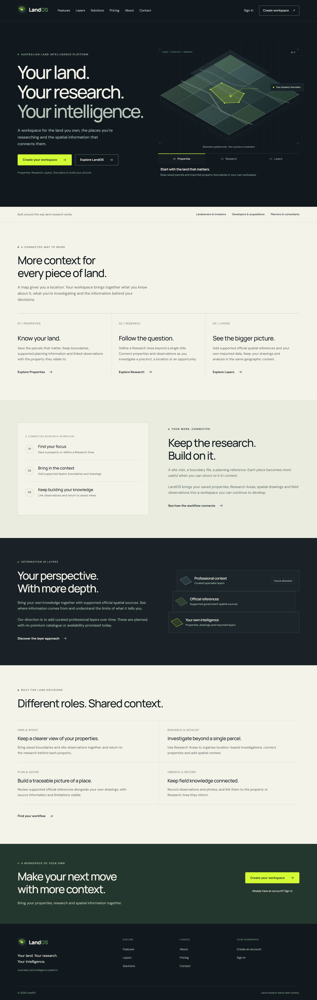
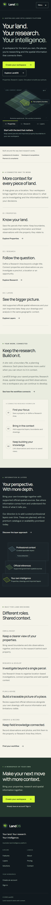

# Build LandOS public marketing website V1

LandOS's single introductory landing page becomes a complete public website centred on Properties, Research and Layers, with the positioning “Your land. Your research. Your intelligence.”

## Changes

- Seven pages: `/`, `/features`, `/layers`, `/solutions`, `/pricing`, `/about`, `/contact`.
- Shared accessible navigation, footer, CTA, content and interactive spatial illustration components in `src/components/marketing/`, with scoped CSS Modules.
- Terrain Layers brand and existing Manrope/DM Sans retained. Dark hero, warm paper sections and original artwork explicitly labelled as illustrative.
- Feature claims grounded in current repository evidence. Professional layers and commercial plans are identified as future; no invented prices, allowances, trials or endorsements.
- Per-page SEO, canonical/Open Graph/Twitter metadata, social image, marketing-only sitemap and crawler policy. Preview builds use noindex and disallow crawling.
- Real `/signup` and `/login` links. No-inbox contact state downloads an enquiry draft; an owner-approved `LANDOS_CONTACT_EMAIL` enables email-client preparation without adding a sending service.
- Browser regression script, reviewed screenshots and a source/limitations report in `docs/marketing/V1.md`.

Only the existing homepage and a short STATUS entry are modified; all other changes add marketing routes, components, assets or review evidence. Authenticated application, GIS, shared CSS, Auth, proxy, share route, Supabase, brand masters and dependencies are unchanged. No MaxQI change.

## Validation

- `npm run lint`, `npm run typecheck`, `npm test`: pass; 53 existing tests.
- `npm run build`: pass; seven static marketing routes, original application/share routes retained.
- `node tests/marketing.e2e.mjs`: pass against production build with installed Chrome. 28 page/width checks at 1440/768/390/320 px, keyboard/mobile menu, focus, skip link, pillar selector, FAQ, enquiry download, real account CTAs and SEO.
- No page exceptions, failed requests or application API/MapLibre worker requests in public-page checks.
- Protected paths compared with latest main `cbb7638a7f3116122e70427b00edc3e21f7817fa`: unchanged. No source conflicts.

## Review and remaining limits

See [V1 report](V1.md) and [verification JSON](verification.json).





No public contact inbox was supplied; addressed email preparation needs owner configuration. Full authenticated production/GIS/database E2E, real email confirmation and physical Safari/device acceptance were not run from this isolated checkout. No production deployment is claimed. Review before any separately authorised merge.

## Publication handoff

The implementation and documentation are committed locally on `website/public-site`. Ordinary Git push failed because the Windows credential store could not provide credentials. The connected GitHub write interface also refused execution because this session's approval policy is `never`. No remote branch or PR has been created from this session.

From a terminal with GitHub authentication, in this checkout:

```text
git push -u origin website/public-site
gh pr create --repo maxstillwell/landbanker --base main --head website/public-site --title "Build LandOS public marketing website V1" --body-file docs/marketing/PULL_REQUEST.md
```

Alternatively, fetch `website/public-site` from the supplied Git bundle into another authenticated clone, check out that branch, then run those publication commands. The bundle requires the audited main/base commit already present in that clone. Do not force-push, merge or deploy production as part of this handoff.
